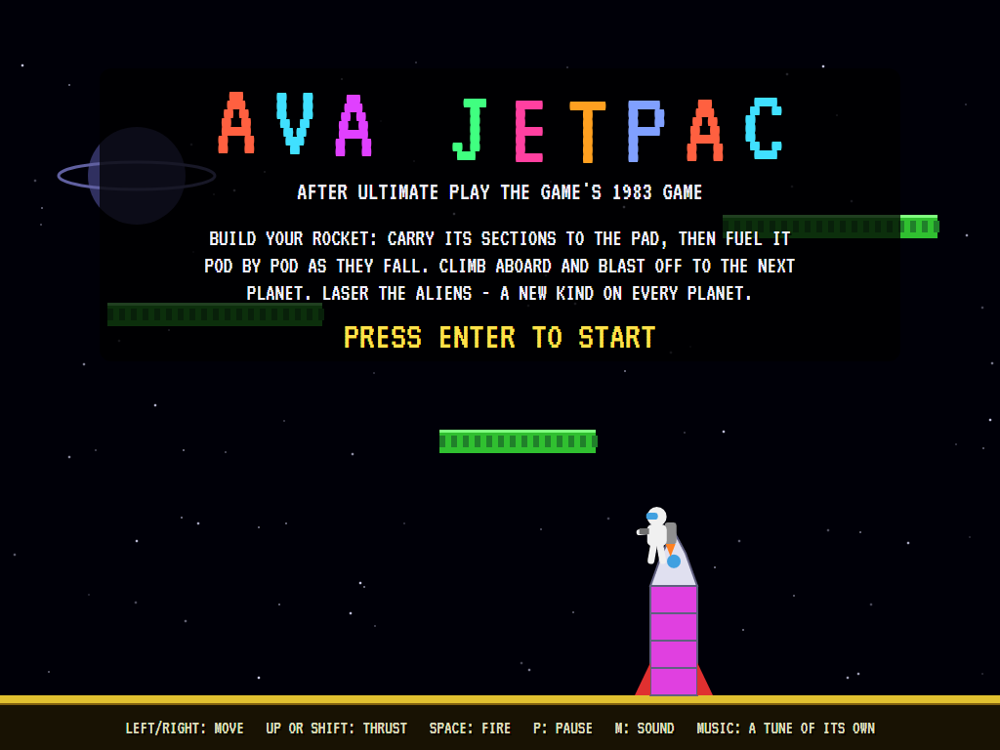
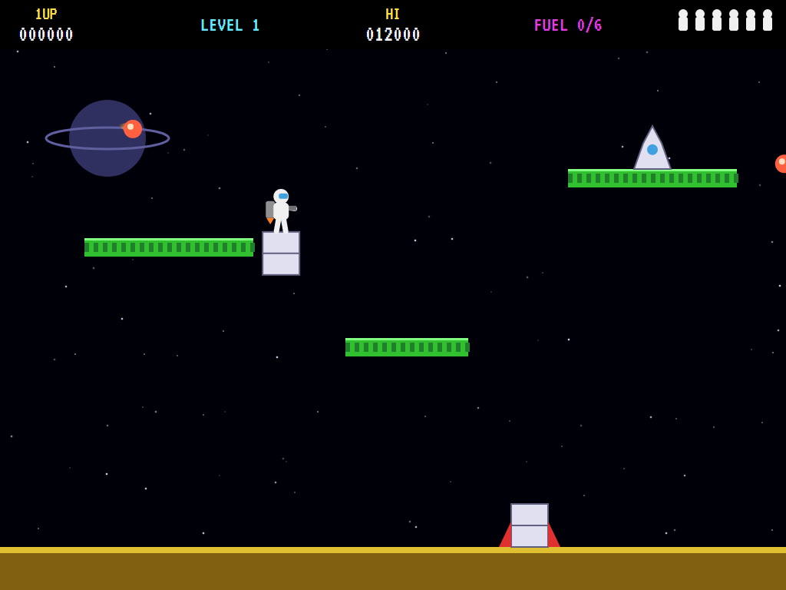
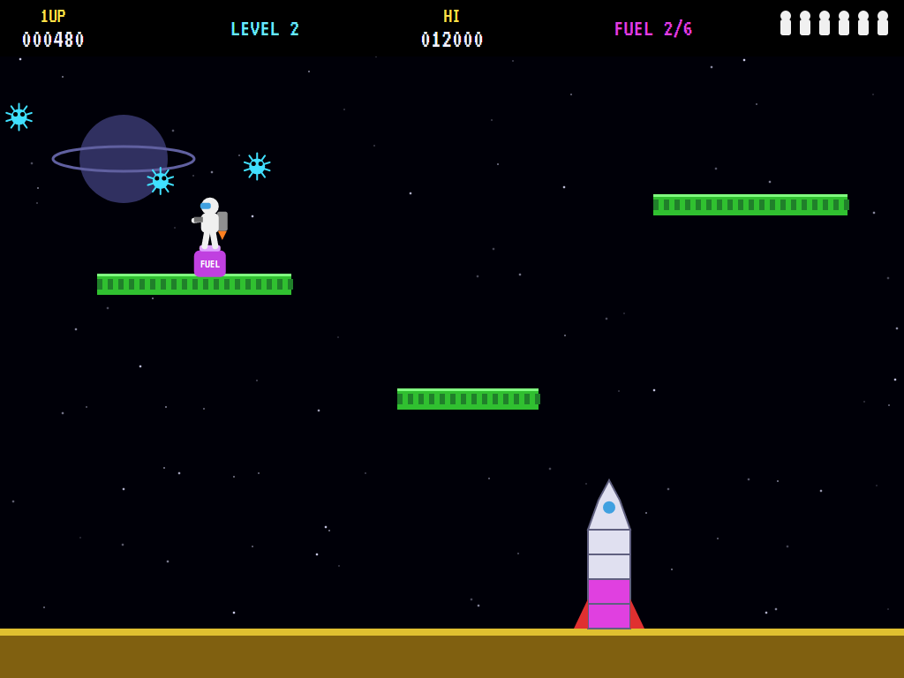
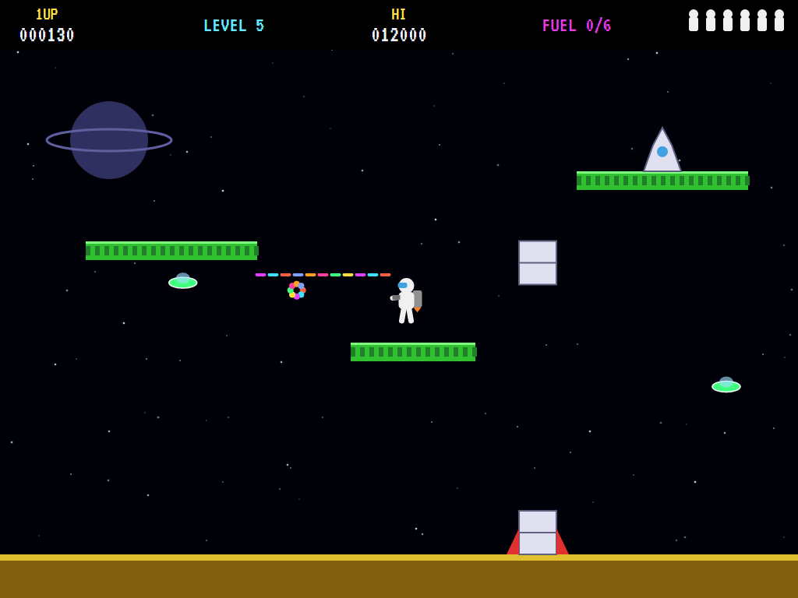
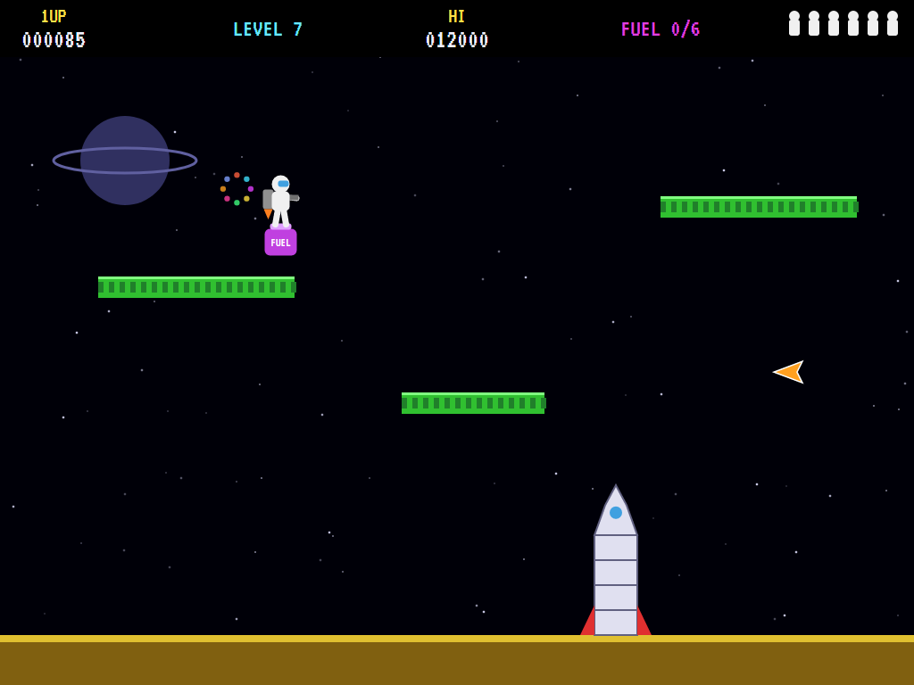
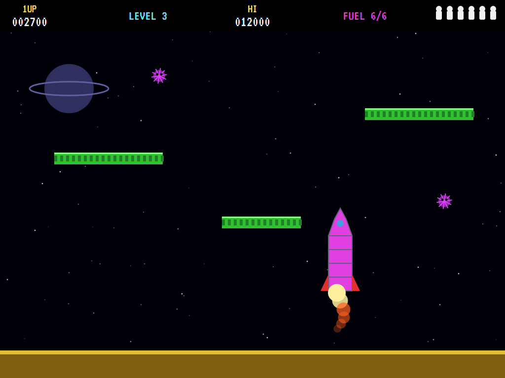
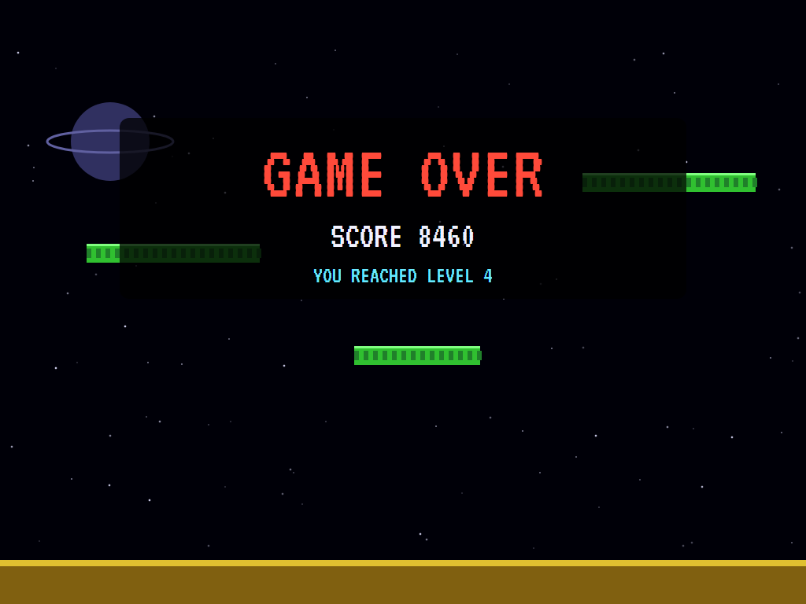
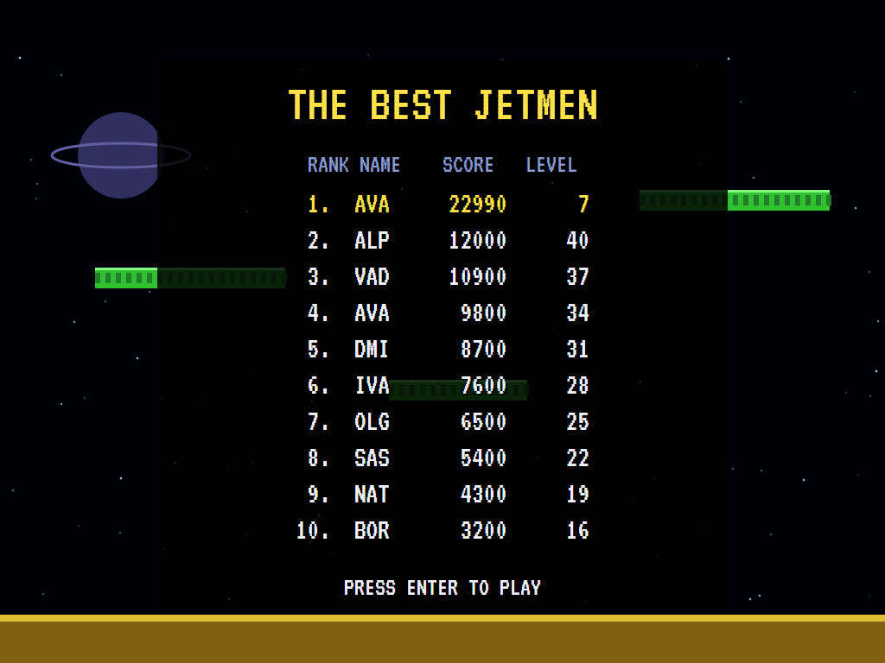

# AVA Jetpac

[](https://github.com/Harlock123/AVAJetpac/actions/workflows/build.yml)

A jetpack shooter in the style of Ultimate Play the Game's 1983 **Jetpac**, built with .NET 10 and Avalonia UI.
Build your rocket by carrying its sections to the pad, then fuel it pod by pod as they fall. Climb aboard and
blast off to the next planet, lasering the aliens as you go: a new kind on every planet.

## Features

- **The rocket:** every fourth planet it starts in three pieces. The middle section and the nose lie on the
  ledges, and each must go on in order: carry it over the pad and it drops into place. Then six fuel pods
  fill it, falling from the sky one at a time. When it's full, walk aboard and it takes off.
- **Jetman** walks on the ground and the ledges, flies on his jetpack, bumps his head on the ledges from
  below, and wraps round from one side of the screen to the other.
- **The laser** shoots a rainbow streak ahead, two at a time.
- **Eight kinds of alien**, one to a planet, faster and more of them as you go. Meteors fly straight and burst
  on whatever they hit. Fuzzballs, bubbles, crosses and frogs bounce off everything. Jets, saucers and falcons
  come after you. Gems drop now and then for 250 points.
- **Scoring:** 25 to 95 an alien, 100 for each section and pod fitted, 250 a gem; four lives and another
  every 10,000.
- **The attract mode** shows the computer Jetman at work. It knows what the rocket needs next and where that
  is, and keeps a map of the way there round the ledges. Every few moments it tries every pair of moves
  (left, right or neither; thrusting or not) on a copy of the planet. It takes the one that ends nearest what
  it's after without an alien getting it, counting kills along the way. The laser fires at any alien in line.

## Screenshots

| The title | A section | Fuel |
|:---------:|:---------:|:----:|
|  |  |  |
| | The middle, to the pad. | Pod by pod. |

| The laser | A burst | Lift-off |
|:---------:|:-------:|:--------:|
|  |  |  |

| Game over | The best Jetmen |
|:---------:|:---------------:|
|  |  |

The screenshots are made by the tests, which play the game in a real (headless) window; see
[Tests](#tests).

## Download and run

Ready-to-run builds for Windows, macOS and Linux, on both Intel/AMD and ARM, are on the
[Releases page](https://github.com/Harlock123/AVAJetpac/releases/tag/latest). **Latest build** is
rebuilt on every push to `main`. Each download is one self-contained executable: no .NET install is
needed.

| Platform | Archive |
|---|---|
| Windows | `AVAJetpac-win-x64.zip`, `AVAJetpac-win-x86.zip`, `AVAJetpac-win-arm64.zip` |
| macOS | `AVAJetpac-osx-arm64.tar.gz` (Apple silicon), `AVAJetpac-osx-x64.tar.gz` (Intel) |
| Linux | `AVAJetpac-linux-x64.tar.gz`, `AVAJetpac-linux-arm64.tar.gz`, `AVAJetpac-linux-arm.tar.gz` |

```bash
tar -xzf AVAJetpac-linux-x64.tar.gz     # or linux-arm64, linux-arm, osx-arm64, osx-x64
./AVAJetpac
```

On Windows, unzip and run `AVAJetpac.exe`. On macOS, if Gatekeeper refuses to open it, run
`xattr -d com.apple.quarantine AVAJetpac` once. Run with `--no-audio` for silence.

**Sound** comes through OpenAL Soft, built in for every platform. In a virtual machine the game
detects it and uses a larger audio buffer, so the sound doesn't break up.

**Gamepads** use SDL2, which is bundled for Windows, macOS and Intel/AMD Linux. ARM Linux builds need it
installed; without it the keyboard still works:

```bash
sudo apt install libsdl2-dev            # Debian / Ubuntu / Raspberry Pi OS
sudo pacman -S --needed sdl2-compat     # Arch / Omarchy
```

## Controls

| Action | Keyboard | Gamepad |
|---|---|---|
| Start | Enter or 1 | Start |
| Move | Left/right arrows, or A/D | Left stick / D-pad |
| Thrust | Up, W or Shift | A or up |
| Fire | Space, Ctrl, Z or X | B or X |
| Pause | P or Esc | Start |
| Sound on/off | M | |
| Screenshot | Ctrl+S (to your Pictures folder) | |

On the high-score table, type your initials, or use up/down and Space, then Enter.

## Tests

```bash
dotnet test AVAJetpac.slnx
```

The game runs in fixed 60 Hz steps, so it plays the same at any frame rate. Everything that changes lives in
one world that can be copied. The tests check:

- **The rocket:** in pieces every fourth planet, built the rest; sections fitted in order, carried over the
  pad; fuel pods falling once it's built, and six filling it; aboard, and away.
- **Jetman:** walking, falling, thrusting, and wrapping round; a ledge holding him up and bumping his head.
- **Aliens:** the laser killing one for points, and one killing Jetman; meteors bursting on the ground, and
  homers coming after him; gems.
- **The game:** a life lost, dropping what he carried, and back by the rocket; lives running out; the
  demonstration and high scores; pause; a copied world; the keys.
- **The computer Jetman:** through the first four planets; flying about at random never builds the rocket.

`tests/AVAJetpac.Tests/PilotProbe.cs` reports how the computer Jetman gets on, for tuning (`JETPAC_PROBE=1`).
It gets through twelve planets in ten minutes without losing a life. `JETPAC_PROBE=lazy` flies to and fro
firing and never gets the first section to the pad.

The screenshot tests draw the real screen in a headless window. To refresh the README's pictures:

```bash
JETPAC_SHOTS=$PWD/Images dotnet test tests/AVAJetpac.Tests --filter ScreenshotTests
```

## Building

```bash
dotnet build AVAJetpac.slnx
dotnet run --project src/AVAJetpac
```

Needs the .NET 10 SDK. The sounds, music and voice are made by `tools/make_sounds.py` (standard-library
Python, with the formant voice in `tools/speech.py`): `python3 tools/make_sounds.py` rewrites
`src/AVAJetpac/Sounds`.

## Project structure

```
AVAJetpac/
├── AVAJetpac.slnx
├── src/AVAJetpac/
│   ├── Engine/
│   │   ├── GameEngine.cs        # States, planets, lives, the demonstration
│   │   ├── Sim.cs               # Jetman, the laser, the rocket and what's carried to it, the aliens
│   │   ├── World.cs             # The planet's layout, and everything that changes, kept so it can be copied
│   │   ├── Pilot.cs             # The computer Jetman (the demonstration, and the tests)
│   │   ├── HighScoreTable.cs, InitialsEntry.cs
│   │   ├── InputHandler.cs, ControllerManager.cs  # Keys and an SDL2 gamepad
│   │   └── SoundManager.cs      # Effects, music and voice through OpenAL
│   ├── Audio/                   # The OpenAL engine (from the author's AVABand)
│   ├── Views/GameCanvas*.cs     # Space, the ledges, the rocket, Jetman and the aliens, the title
│   └── Sounds/                  # The synthesised effects, music and voice
├── tests/AVAJetpac.Tests/       # Gameplay and screenshot tests
├── tools/make_sounds.py, tools/speech.py
└── Images/                      # Screenshots
```

## About and licence

AVA Jetpac © 2026 Lonnie Watson, under the [MIT License](LICENSE).

*Jetpac* © 1983 Ultimate Play the Game (Tim and Chris Stamper); the names *Jetpac* and *Jetman* belong to their
current owner. AVA Jetpac is an independent, unofficial game in its style. Its graphics, sounds and code are its
own; nothing is taken from the original game's program, graphics or sound. It is not affiliated with or endorsed
by any rights holder.
